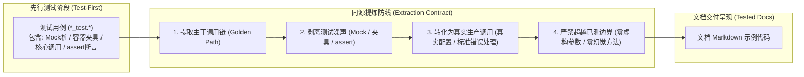

<!-- Specification: oss-template-agents-ext v1.0.0 (quality-tested-docs) | Updated: 2026-10-21 -->
# 文档工程与测试保真准则 (Tested Documentation & Feature Coverage)

本扩展规范定义了 AI Agent 在开发**基础设施套件、底层 SDK、通用工具库、前后端业务系统**时，必须无条件遵循的文档工程与测试保真底线。核心解决两项关键工程顽疾：**“只写代码不写文档的黑盒盲区”** 与 **“文档示例代码凭空捏造、复制即报错的伪代码幻觉”**。

---

## 1. 零未文档化功能红线 (Zero Undocumented Feature Invariant)

在高质量软件交付中，**未经文档记录的功能等于不存在**。AI Agent 在交付任何新增或变更的代码时，必须确保其能力 100% 在技术文档中得到清晰映照。

### 1.1 强制文档化范畴 (Mandatory Scope)
凡具备外部可观测性或供调用方消费的代码资产，均属于强制文档化对象，严禁暗箱交付：
1. **对外公开 API / 导出接口**：公共类、公开函数、导出方法、RPC 契约与 REST 路由；
2. **系统配置项**：配置文件参数、环境变量、CLI 命令行参数及默认缺省值；
3. **前端核心资产**：可复用 UI 组件、公共 Hooks、外部 Props / Emits 契约；
4. **异常与错误码**：业务错误码字典、已知异常类型、降级与容错表现。

### 1.2 三层文档覆盖标准 (Three-Tier Documentation)
根据项目规模与交付层级，文档覆盖必须形成清晰的梯队：
- **第一层：快速开始 (Quickstart / README)**：体现系统核心价值，提供一套复制即用的端到端极简调用示例；
- **第二层：场景指南 (Usage Guides)**：覆盖该特性的主流业务场景、高级选项组合及最佳实践模式；
- **第三层：参数参考 (API Reference / Data Contracts)**：对每个公共接口的入参出参数据结构、边界限制提供详尽说明。

> **交付红线**：代码已编写、单测已跑通，但相关公共方法或配置在对应文档中未作记录者，一律视为**未达交付标准 (Incomplete Delivery)**，禁止发起合并或宣称完成。

---

## 2. 测试先行保真与生产用法提炼契约 (Tested Code Extraction)

针对“测试用例代码充斥着测试夹具与断言，无法直接作为生产用法呈现，但文档代码又必须经过测试验证”的客观工程矛盾，AI Agent 必须严格执行**“主干同源提取 ➔ 剥离测试噪声 ➔ 规范生产调用”**的转化契约。



### 2.1 核心提炼准则 (Four Invariants)

1. **准则一：主干同源提取 (Golden Path Extraction)**
   - 文档中展示的任何可运行代码片段，其涉及的组件实例化、核心方法调用流向与数据消费逻辑，**必须完整源自一个已经编写并 100% 运行通过的先行测试用例**。
2. **准则二：测试噪声主动剥离 (Noise Stripping)**
   - **剔除断言**：主动去除测试用例中的 `assert.Equal`、`assertThat`、`expect(...).toBe(...)` 等验证专用语句；
   - **剔除测试环境桩**：去除测试容器（Testcontainers）启动、Mock 框架打桩、临时测试目录创建、内存 DB 重置等测试环境专用噪点；
   - **规范化生产形态**：将测试上下文变量替换为开发者在生产中实际书写的代码（如真实配置加载、面向调用者的标准异常处理 `if err != nil` 或 `try...catch`）。
3. **准则三：零越界幻觉 (Zero Hallucination Invariant)**
   - **坚决封死参数虚构**：文档示例中调用的任何接口、传递的参数组合与属性赋值，**必须严格限制在已测通的范围之内**；
   - **严禁虚构便捷封装**：严禁为了让文档“看起来更简洁”而在文档中凭空捏造测试中并未真实实现的伪重载方法或隐式参数。
4. **准则四：代码追溯注记 (Tested-By Citation)**
   - 为确保文档代码 100% 可审计、可追溯，文档编写代码块时，推荐在 Markdown 代码块上方添加 HTML 注释标记其对应的先行测试用例源：
     ```markdown
     <!-- Tested-By: tests/infra/storage_test.go#TestStorage_UploadFile -->
     ```go
     // 初始化生产存储客户端
     client, err := storage.NewClient(ctx, storage.Config{
         Endpoint: "https://oss-cn-hangzhou.aliyuncs.com",
         Bucket:   "my-bucket",
     })
     if err != nil {
         log.Fatalf("failed to init storage: %v", err)
     }

     // 上传文件对象
     resp, err := client.UploadFile(ctx, "data.csv", reader)
     if err != nil {
         return fmt.Errorf("upload failed: %w", err)
     }
     fmt.Printf("File uploaded successfully, ETag: %s\n", resp.ETag)
     ```
     ```

---

## 3. 三板斧验收标准 (Completion Criteria)

任何新增或变动的功能，在文档与用例交付时必须完整呈现“三板斧”，缺一不可：

1. **场景痛点 (Pain Point)**：用一两句话直白陈述解决的业务痛点或工程问题；
2. **可运行用例 (Tested Minimal Example)**：提取自先行测试、已剥离噪声并带有 `Tested-By` 追溯标记的生产可用最小代码示例；
3. **预期呈现 (Expected Output)**：明确给出该代码运行成功时的预期控制台输出、API 响应 JSON 或数据变更形态（真实截取自实际测试运行结果）。

---

## 4. 交付前自检硬卡点 (Pre-flight Checklist)

在宣布特性开发完成前，必须逐项执行以下自检：

- [ ] **全功能映照检查**：检查本次提交的所有导出方法、新入参、新配置项，是否已在对应的 README、指南或接口参考文档中建立对应词条？
- [ ] **同源测试先行检查**：文档中的每一个代码示例，是否均能在测试套件中找到通过验证的对应测试用例？
- [ ] **测试噪声剥离检查**：文档代码是否已完全去除断言语句（`assert`）、Mock 设置与测试专用上下文，呈现为优雅地道的生产消费形态？
- [ ] **参数边界真实性检查**：文档中代码传入的每一个配置值、调用的每一个函数，是否均在测试覆盖边界内，无任何臆造成分？
- [ ] **预期输出真实性检查**：文档给出的“预期呈现”是否真实来源于测试实际运行输出，杜绝脑补输出？
