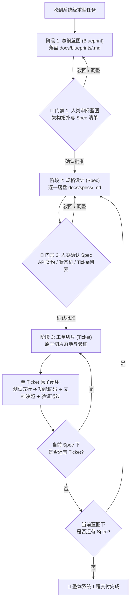
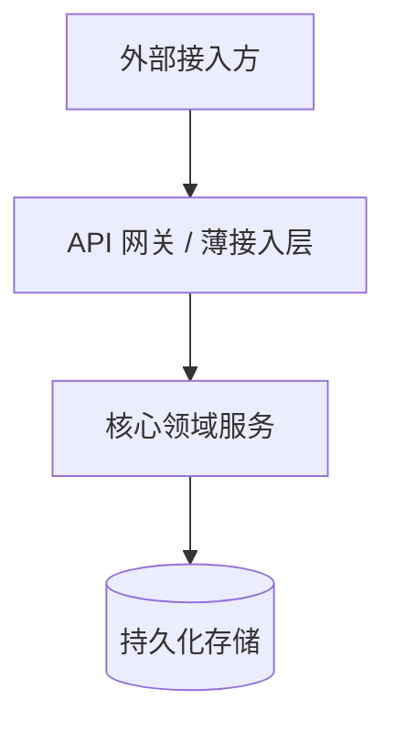
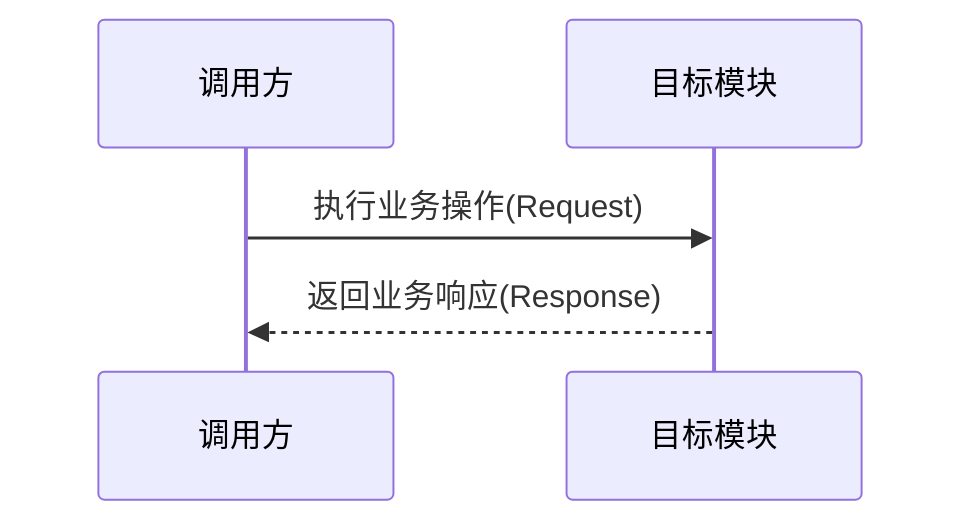

<!-- Specification: oss-template-agents-ext v1.0.0 (workflow-blueprint-spec-ticket) | Updated: 2026-10-21 -->
# 复杂任务推进范式：总纲蓝图 ➔ Spec 契约 ➔ Ticket 切片 (Workflow Extension)

本扩展规范定义了 AI Agent 在面对**大型系统工程、全新子系统引入或跨模块架构重构**时，必须严格执行的“总纲蓝图先行、Spec 渐进切片落地”工程推进工作流。通过分层下钻与阶段性显式门禁，彻底杜绝“盲目动工、上下文爆炸、交付半成品”等失控风险。

---

## 1. 触发门槛与判定准则 (Trigger Thresholds)

为防止小题大做与过度工程化，本三级工作流**仅在系统级重型任务中强制触发**：

### 1.1 强制触发场景 (Mandatory Invariants)
凡满足以下任一条件的开发任务，AI Agent **严禁直接编写业务源码**，必须启动本工作流：
1. **全新工程/子系统引入**：新建独立的微服务、独立公共 SDK、底层核心基础设施套件或全新顶层业务模块；
2. **跨系统/跨模块重构**：修改底层共享数据模型、核心领域实体或跨模块公共 RPC/API 协议契约，影响面涉及 2 个以上独立模块；
3. **非平凡底层迁移**：核心依赖框架大版本升级（如 Spring Boot 2 升 3、ORM 框架重构替换、网络协议栈重写）；
4. **宏观系统设计指令**：用户显式输入包含“系统设计”、“架构蓝图”、“从零搭建完整系统”、“系统级重构”等意图明确的指令。

### 1.2 排除场景 (Exemption)
- 常规单一模块 CRUD 接口新增；
- 局部特定 Bug 修复与回归加固；
- 既有模块内部私有逻辑优化（不影响公共契约）；
- 简单页面或单一组件呈现调整。
> 上述轻量任务一律直接走常规工单或单 Spec 敏捷推进，严禁滥用三级大流程打扰人类研发节奏。

---

## 2. 三阶段流水线与门禁规范 (Phased Pipeline & Approval Gates)



---

### 阶段 1：总纲蓝图 (Blueprint)

- **核心职责**：宏观把握系统愿景、绘制架构拓扑防线、划分领域模块边界、制定演进路线图，严禁下钻细节代码。
- **落盘规范**：必须以工程受管文档形式落盘至 `docs/blueprints/<system-name>.md`。
- **必备核心要素**：
  1. **背景痛点与系统目标**：清晰陈述为何要做、要解决的核心问题；
  2. **架构拓扑与边界防线**：使用 Mermaid 绘制系统上下文图（Context Diagram）或模块调用拓扑图，明确内外部边界；
  3. **核心领域模型与数据流向**：梳理核心实体关系与关键业务流转链路；
  4. **Spec 演进拆解清单**：将整个系统拆解为一组相互解耦、阶段递进的 Spec 规格清单（Spec 1..N），标明优先级与依赖依赖关系。
- **🚨 门禁 1 (Blueprint Approval Gate)**：
  - 产出蓝图文件后，AI Agent **必须立即挂起暂停一切后续动作**；
  - 在交互会话中向用户汇报蓝图核心设计提纲与文件链接；
  - **在人类开发者明确给出“批准/确认/推进下一步”之前，严禁擅自编写任何 Spec 或代码**。

---

### 阶段 2：规格说明 (Spec)

- **核心职责**：根据蓝图划分的模块，深度设计单一模块的技术规格、公开契约与边界逻辑。
- **落盘规范**：按模块落盘至 `docs/specs/<module-name>.md`。
- **必备核心要素**：
  1. **模块职责边界**：承接蓝图中的哪部分职责，明确输入与输出；
  2. **对外公开契约 (API / RPC / CLI)**：接口签名、请求与响应数据结构、状态码、配置项定义；
  3. **时序与状态机**：针对关键流程使用 Mermaid 绘制时序图或状态流转图；
  4. **异常分支与防御策略**：超时、降级、重试、并发冲突与安全防御机制；
  5. **测试策略设计**：拟定的单元测试与集成测试覆盖范围；
  6. **原子工单拆解 (Ticket Breakdown)**：将本 Spec 拆解为可独立开发验证的原子 Ticket 清单（Ticket 1..M）。
- **🚨 门禁 2 (Spec Approval Gate)**：
  - 产出 Spec 文件后，AI Agent **必须向用户汇报该模块的契约摘要与 Ticket 规划**；
  - 获得人类开发者确认或指示“开始执行”后，方可启动具体的工单切片。

---

### 阶段 3：工单切片落地 (Ticket Execution)

- **核心职责**：将 Spec 细化的原子任务逐项编码落地，遵循最小爆炸半径。
- **原子切片执行四部曲 (Atomic Execution Cycle)**：
  每一个 Ticket 落地必须闭环执行以下步骤，严禁颠倒次序或省略步骤：
  1. **先行测试 (Test-First)**：首先根据 Spec 契约编写针对当前切片的测试用例（单元测试/集成测试），断言关键路径与异常分支；
  2. **功能编码 (Implementation)**：编写业务源码，以最干净地道的方式使先行测试用例 100% 成功通过；
  3. **文档映照 (Tested Docs Sync)**：若当前 Ticket 涉及对外能力变动，同步更新配套的技术文档/使用指南，提取纯净生产代码示例；
  4. **本地验证 (Verification)**：在本地以无头模式运行项目检查与测试套件，确保全绿无退化。
- **切片交付汇报**：
  - 每完成一个 Ticket，向用户输出极简汇报（已完成的断言能力、测试通过状态、受影响文件链接）；
  - 保持工作区整洁，等待下一切片推进指令或批量交付指令。

---

## 3. 标准交付物骨架模板 (Markdown Skeletons)

### 3.1 蓝图骨架示例 (`docs/blueprints/<system-name>.md`)
```markdown
# 架构总纲蓝图：<系统/模块名称>

- **规划版本**：v1.0.0
- **创建时间**：YYYY-MM-DD
- **关联工单**：#123

## 1. 业务痛点与系统目标
一句话阐明本系统或本次重构解决的核心痛点与验收底线。

## 2. 系统架构拓扑


## 3. 领域划分与模块依赖边界
阐述各子模块划分意图与严格依赖流向。

## 4. Spec 规划演进路线
1. **Spec 1: `<模块A>`** (核心基础设施 / 协议契约) - 优先级: P0
2. **Spec 2: `<模块B>`** (业务主流程 / 核心引擎) - 优先级: P0 (依赖 Spec 1)
3. **Spec 3: `<模块C>`** (监控指标 / 管理端 API) - 优先级: P1 (依赖 Spec 2)
```

### 3.2 规格说明骨架示例 (`docs/specs/<module-name>.md`)
```markdown
# 规格说明：<模块名称> (Spec)

- **所属蓝图**：[<系统蓝图>](../blueprints/<system-name>.md)
- **状态**：Draft / Approved / In-Progress / Completed

## 1. 模块职责与契约定义
详细说明对外暴露的函数签名、DTO 实体、配置项格式。

## 2. 核心交互时序 / 状态机


## 3. 边界防卫与异常处理
阐明空安全、超时、幂等及降级处理。

## 4. 原子工单拆解 (Tickets)
- [ ] **Ticket 1**: 数据结构定义与核心契约先行测试 (P0)
- [ ] **Ticket 2**: 核心业务逻辑实现与存储适配 (P0)
- [ ] **Ticket 3**: 错误分支覆盖与生产使用文档同步 (P1)
```
